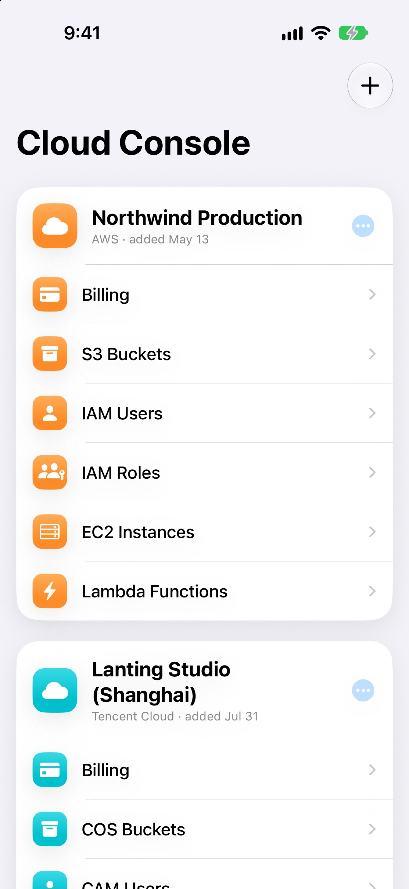
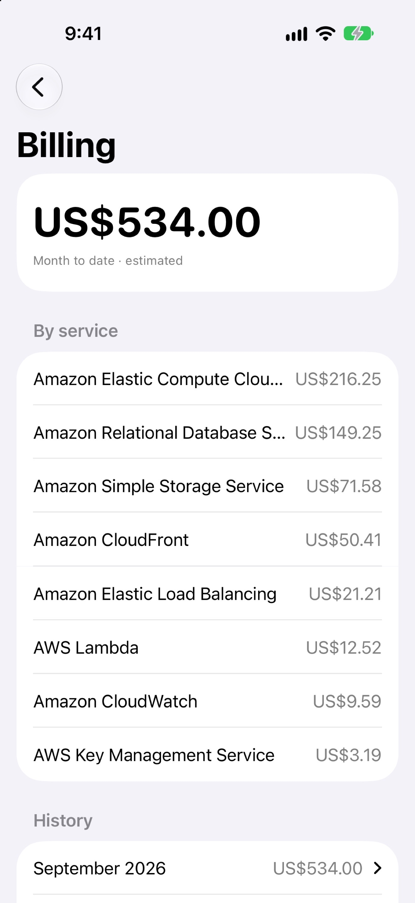
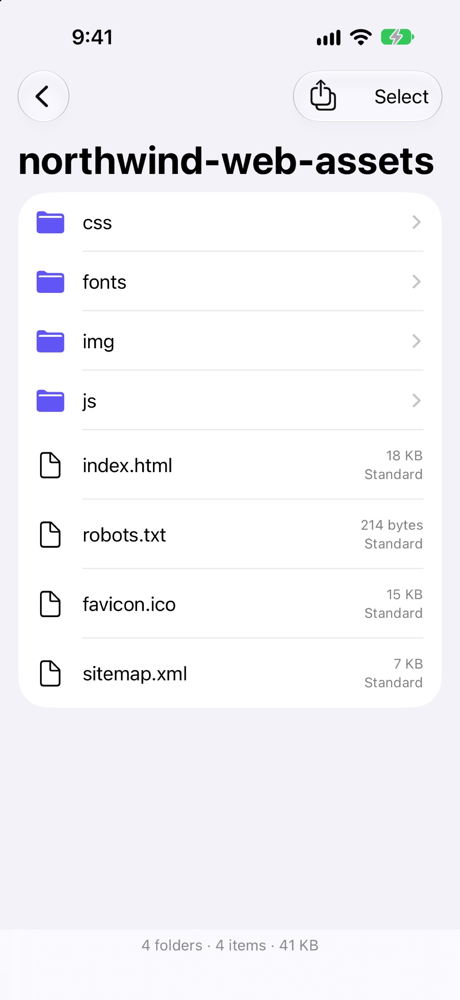
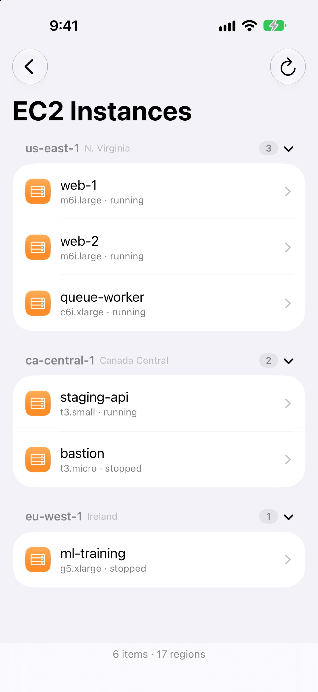
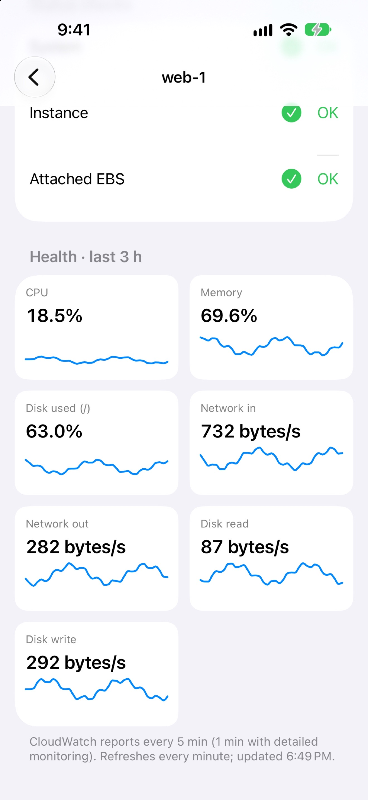
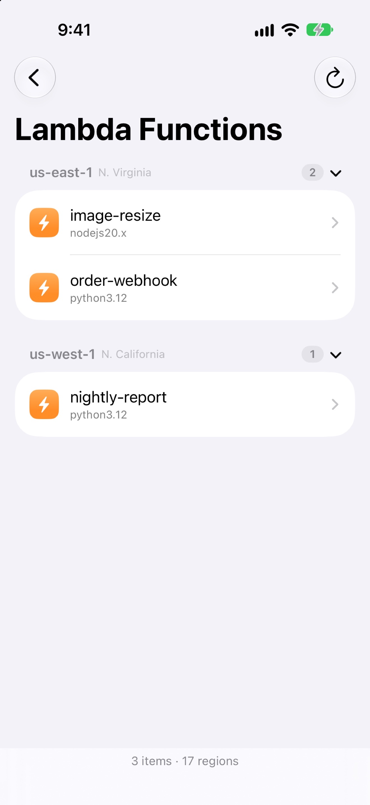
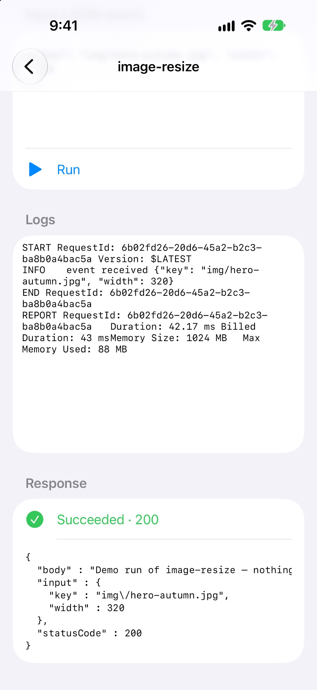
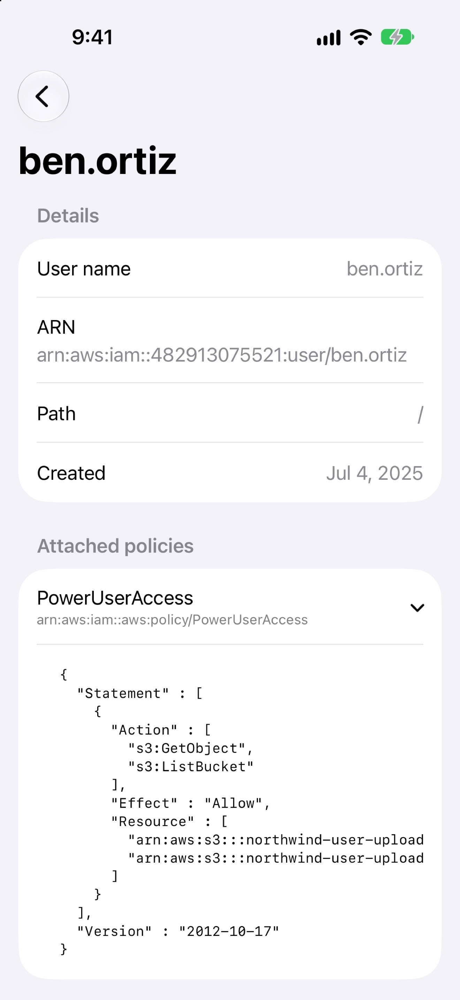
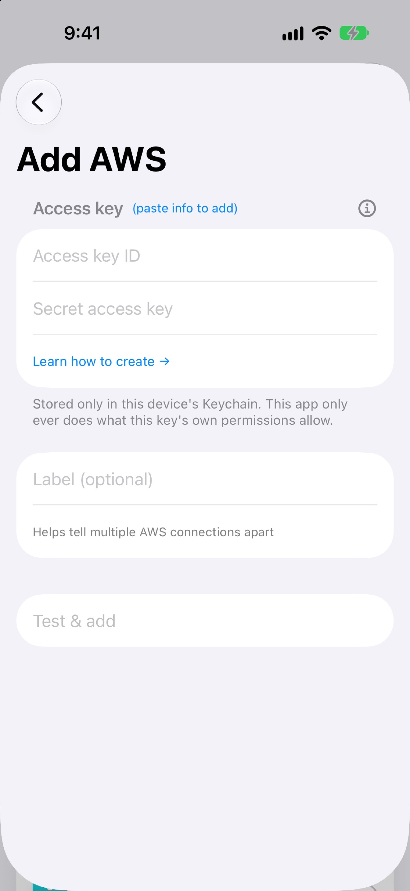
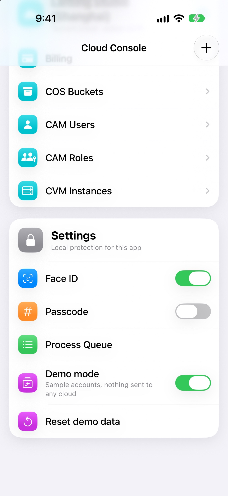

# Cloud Console

A console for your cloud accounts, on your phone and in a Chrome side
panel. Connect with an access key or credential file, browse and manage
resources with whatever permissions that credential has — no backend
server, no IaC, nothing of ours in between.

## Repo layout

```
apps/
  mobile/    iPhone app — React Native (Expo), TypeScript. Replaces apps/ios.
  ios/       the original SwiftUI app, kept as reference until mobile reaches parity
  chrome/    Chrome Cloud Console — side panel extension (TypeScript + esbuild)
packages/
  core/      shared TypeScript: request signing (SigV4, TC3, Google OAuth/JWT),
             provider API clients, storage clients, resource catalog, demo data loader
  demo/      demo-mode preset data (JSON), shared by both apps
docs/        access keys, GCP access, release, UI/UX design
```

`packages/core` runs unchanged in Chrome and in React Native (Hermes has
no `crypto.subtle`, so hashing is pure JS). Apps import it from source as
`@cloud-console/core/<path>` — no build step for the package.

```
npm install          # once, at the repo root (npm workspaces)
npm test             # core unit tests
npm run typecheck    # every package
```

Per app: [apps/mobile/README.md](apps/mobile/README.md),
[apps/chrome/README.md](apps/chrome/README.md).

## Screenshots

| | | |
|---|---|---|
| **Home**<br> | **Billing**<br> | **S3 bucket**<br> |
| **EC2 by region**<br> | **Instance health**<br> | **Lambda**<br> |
| **Run + live logs**<br> | **IAM policy**<br> | **Add connection**<br> |
| **Settings**<br> |  |  |

## How it works

- **One access key per connection.** Paste in an access key when you
  add a cloud account; that's the only credential involved. The app
  never combines keys, never proxies through a server, never does
  anything the key's own permissions don't already allow.
- **Direct to the provider's API**, signed on-device (AWS SigV4, Tencent
  TC3/COS, Google service-account JWT / refresh token — see
  `packages/core/src/{aws,tencent,gcp}`). No cloud SDK, no third-party
  service sees your traffic or your key.
- **Stored locally only.** Keychain on the phone; `chrome.storage.local`
  (never synced) in the extension. Keys never leave the device except in
  signed requests to the provider's own endpoints.

## Providers & resources

Built incrementally, one resource kind at a time. Only implemented ones
show in the UI — the single list is `packages/core/src/catalog.ts`
(`isImplemented`, per-platform availability).

### Mobile

| Provider | Billing | Storage | Users & roles | Compute | Functions | Events | Config |
|---|---|---|---|---|---|---|---|
| AWS | Cost Explorer | S3 (browse, preview, share, upload, copy/move/rename/delete) | IAM + policies | EC2 + status checks, metrics | Lambda: list, run, live logs | EventBridge rules, buses, schedules | SSM Parameter Store (SecureString revealed on tap) |
| Tencent Cloud | bill summary, balance | COS | CAM + policies | CVM | — | EventBridge (CEB) | — |

Not yet: RDS, alarms, Tencent SCF/CDB; Azure, Google Cloud, Alibaba.

### Chrome

| Provider | Storage | Other |
|---|---|---|
| AWS | S3, S3-compatible (R2, MinIO…) | — |
| Google Cloud | GCS | Projects, Compute Engine VM instances (start/stop/reset), instance groups, Secret Manager (reveal on click) |
| Azure | Blob Storage | — |
| Tencent Cloud | COS (storage only) | — |
| Alibaba Cloud | OSS | — |

Storage: browse, preview/edit, copy/cut/paste, upload, share (URI,
unsigned or signed link). Google Cloud takes a service account JSON key or
gcloud application default credentials (`gcloud auth application-default
login`), loaded once through a file picker — no OAuth flow in the
extension. Roles needed per view: [docs/gcp-access.md](docs/gcp-access.md).

Lambda: run with a JSON input (synchronous, confirmed first) → response. Runtime logs
stream live from `/aws/lambda/<function>` for the current run only, window capped at the function timeout (key needs `logs:FilterLogEvents`).
EC2, Lambda, EventBridge and Parameter Store scan every enabled region (`ec2:DescribeRegions`, else the default 17) one at a time — us-east-1, us-west-1, Canada first — each shown as it finishes, grouped and folded by region with counts; empty regions hidden.

Creating a least-privilege key: [docs/access-keys.md](docs/access-keys.md).

## Demo

- Settings card → Demo mode: switches instantly to sample connections (an AWS and a Tencent account) with buckets, objects, IAM/CAM users and roles with policies, EC2/CVM instances, and a year of billing. Reset demo data restores the preset.
- Separate store: own connection list, no Keychain, no resource cache, no network. Uploads/copies/moves/deletes are not sent.
- Preset data: `packages/demo/connections.json`, `aws.json`, `tencent.json`, keyed by resource kind. Dates relative: `"@today-3 10:00"`, `"@ymd month-2"`, `"@iso today-9 15:22"`, `{today-3}` inside names.
