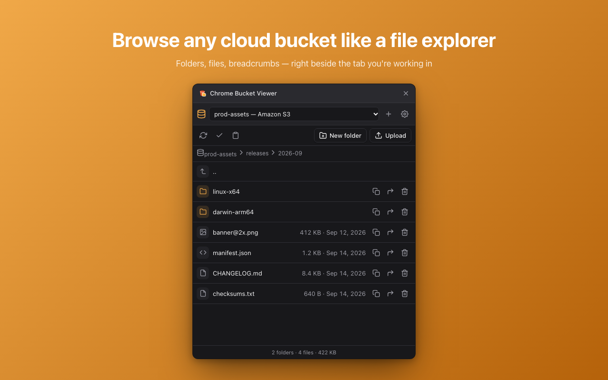
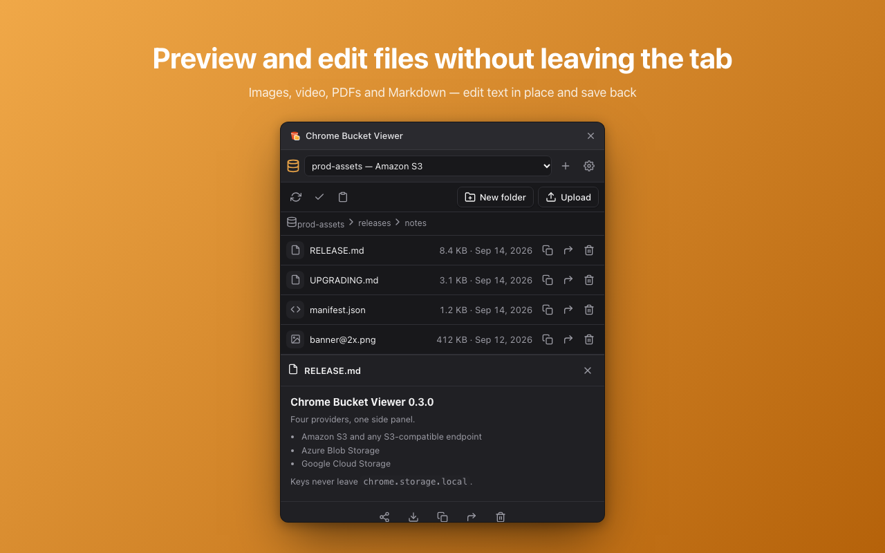
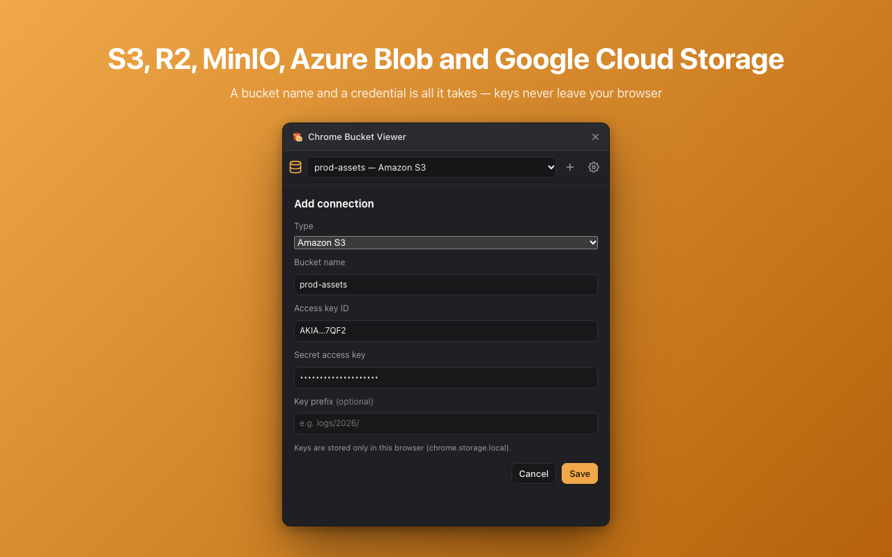

# Chrome Cloud Console

A Chrome side panel for your cloud accounts, laid out like the mobile app:
**Home** shows one card per connection, any vendor, and you drill in from
there. Storage connections browse a bucket like a file explorer — S3,
S3-compatible, Azure Blob Storage, Google Cloud Storage, Tencent Cloud COS,
Alibaba Cloud OSS. Google Cloud accounts open Cloud Storage, VM instances,
instance groups and secrets, per project.

Add one or more connections — pick a type, then just a bucket/container name
and a credential (everything else is optional or auto-detected) — stored
only in your browser, exportable/importable as JSON. Pick a connection and
land straight in that bucket, then browse folders, preview or edit files,
and copy, move or delete objects — all from a side panel that stays open
next to whatever tab you're on. No interactive sign-in for any provider —
S3/S3-compatible/Tencent COS/Alibaba OSS take an access key pair, Azure a
connection string, GCS a service account JSON key or your gcloud
application default credentials.

No cloud SDKs — TypeScript signing requests directly (SigV4 for
S3/S3-compatible/Tencent COS/Alibaba OSS, Shared Key for Azure, a
service-account JWT or refresh token + GOOG4-RSA-SHA256 for GCS), shared
with the mobile app through `packages/core` and bundled with esbuild. See
[docs/design.md](docs/design.md) and
[docs/implementation.md](docs/implementation.md) for how it's built.

## Features

- Home: one card per connection — storage buckets and Google Cloud
  accounts side by side — each listing its resources; tap a row to push
  that screen, back to return. A filter box appears once there are many
  connections. **+** asks what to add: a storage bucket or a Google Cloud
  account.
- Multiple named storage connections, each scoped to one bucket/container. Adding one only strictly needs a
  bucket/container name and a credential — region (where applicable) is
  auto-detected, name defaults to the bucket name, and a starting key
  prefix is optional.
- Six connection types: **Amazon S3**, **S3-compatible** (Cloudflare R2,
  MinIO, etc — endpoint + key pair, nothing else to configure), **Azure Blob
  Storage** (storage account connection string), **Google Cloud Storage**
  (service account JSON key, or gcloud's
  `~/.config/gcloud/application_default_credentials.json` loaded through a
  file picker), **Tencent Cloud COS** and **Alibaba Cloud OSS**
  (both via their own S3-compatible endpoints — key pair + region).
- Save validates the connection against the provider before storing it,
  with progress shown inline (region detection, then a real access check).
- Keys stored locally (`chrome.storage.local`) only; export/import as JSON.
- Browse folders → files with breadcrumb navigation and pagination.
- Preview images, video, audio and PDF inline; edit text/code/Markdown files
  directly (Markdown gets a rendered-preview toggle) and save back.
- Copy/cut/paste files and folders — clipboard-style, with a status
  indicator for what's queued — plus multi-select for bulk copy/cut/delete.
- Share a file as a provider URI (`s3://`, `az://`, `gs://`, `cos://`,
  `oss://`), an unsigned HTTP link, or a signed link with a configurable
  expiry.
- Download files. Create folders, recursive-delete folders.
- Upload a file (or drag-and-drop one) into the current folder.
- Filter the loaded rows of any list as you type.
- Google Cloud accounts (service account key or gcloud ADC): Cloud Storage
  (the project's buckets, each opening the same bucket browser), VM
  instances, instance groups and Secret Manager, each with a searchable
  project picker (type to filter, or type a project ID directly).
- VM instance detail: vCPU/memory, disks, network interfaces and IPs,
  labels, usage over the last 6 hours (CPU, memory with the Ops Agent,
  network, disk), Start/Stop/Reset, serial output. Instance group detail:
  size, template, named ports and member instances, each opening its
  instance detail. Secrets: versions, reveal/copy, never stored.

## Install

1. `npm install` once at the repo root, then `make build` here.
2. Open `chrome://extensions`, enable **Developer mode**.
3. **Load unpacked** → select the `dist/` folder, or run `make zip` and drag
   `chrome-cloud-console.zip` onto the page.
4. Click the toolbar icon to open the side panel, then **+** to add a
   connection.

## Development

```sh
make build      # bundle src/ (+ packages/core) and copy static/ into dist/
make watch      # rebuild dist/ on every change (reload the extension after)
make lint       # tsc --noEmit + validate static/manifest.json
make zip        # lint, build, zip dist/ into chrome-cloud-console.zip
make icons      # regenerate static/icons/icon*.png from the mobile app icon (needs Chrome)
make assets     # regenerate docs/store/*.png (needs Chrome)
make clean      # remove dist/ and the zip
```

Layout: `src/` is the TypeScript UI (`app/` the stack navigator and Home,
`sidepanel/` the bucket browser, `gcp/` the Google Cloud screens, `ui/`
shared search widgets),
`static/` the manifest, HTML, CSS and icons copied as-is, and the storage
clients live in `packages/core/src/storage/` (tests: `npx vitest run` in
`packages/core`). Build tooling comes from the workspace's `node_modules`;
the icon/asset scripts need `python3`. The toolbar icons are the mobile
app's icon (`apps/ios/.../AppIcon.appiconset/icon-light.png`) with rounded
corners; `static/icons/icon.svg` is a vector redraw of it used in the store
art.

`docs/store/` — Chrome Web Store listing assets, all rebuilt by `make assets`
from the real side panel CSS via headless Chrome: screenshots (1280x800),
promo tile (440x280), marquee (1400x560), and
[LISTING.md](docs/store/LISTING.md) with every dashboard field ready to paste.
Privacy policy: [PRIVACY.md](PRIVACY.md).

## Security note

Access keys and secret keys are stored in plaintext in
`chrome.storage.local` (never synced) and are sent only to the endpoint the
connection names. Exporting connections writes those secrets to a plaintext
JSON file — handle exported files like any other credential file. A
"signed link" generated from Share is a presigned/SAS URL: anyone with it
can read that object until it expires, with no further authentication.

## Screenshots






